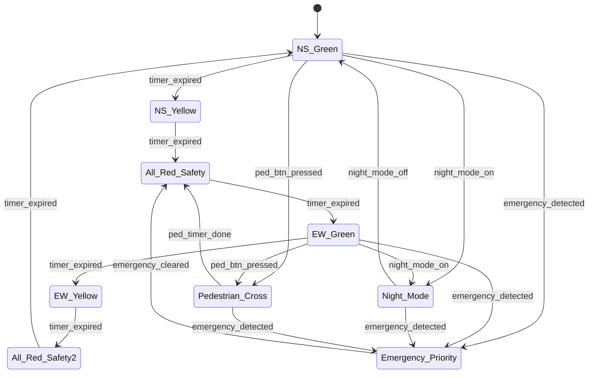

# سیستم چراغ راهنمای هوشمند تقاطع (Smart Traffic Light Controller)
**دانشجو:** علیرضا طاعتی  
**درس:** سیستم‌های نهفته بی‌درنگ (Real-Time Embedded Systems - RTES)  
**ریپازیتوری:** `rtes-project`

---

## معرفی پروژه
این پروژه یک **سیستم چراغ راهنمای هوشمند تقاطع** را در قالب یک سیستم نهفته بی‌درنگ مدل‌سازی و پیاده‌سازی می‌کند. هدف سیستم، مدیریت ایمن و زمان‌بندی‌شده تردد خودروها و عابران پیاده در یک تقاطع چهارراه است؛ به‌گونه‌ای که علاوه بر چرخش استاندارد چراغ‌ها، بتواند با **حالت شبانه**، **درخواست عبور عابر پیاده** و **اولویت اضطراری خودروهای امدادی (آمبولانس و آتش‌نشانی)** به شکل قطعی و ایمن هماهنگ شود.

---

## جدول پورت‌ها و سیگنال‌ها (Port Table)

| نام سیگنال / پورت | جهت | نوع | توضیح عملکرد |
| :--- | :--- | :--- | :--- |
| `PED_BTN_REQ` | ورودی (Input) | دیجیتال / وقفه | دکمه درخواست عبور عابر پیاده |
| `EMG_VEH_SENS` | ورودی (Input) | دیجیتال / وقفه | سنسور یا دریافت سیگنال خودروی اضطراری (آمبولانس / آتش‌نشانی) |
| `TRAFFIC_DENSITY_NS` | ورودی (Input) | سنسور / مقدار عددی | میزان تراکم خودرو در مسیر شمالی–جنوبی |
| `TRAFFIC_DENSITY_EW` | ورودی (Input) | سنسور / مقدار عددی | میزان تراکم خودرو در مسیر شرقی–غربی |
| `NIGHT_MODE_EN` | ورودی (Input) | وضعیت / تایمر | فعال‌سازی حالت شبانه در ساعات کم‌ترافیک |
| `NS_RED`, `NS_YELLOW`, `NS_GREEN` | خروجی (Output) | دیجیتال (GPIO) | کنترل چراغ‌های راهنمای مسیر شمالی–جنوبی |
| `EW_RED`, `EW_YELLOW`, `EW_GREEN` | خروجی (Output) | دیجیتال (GPIO) | کنترل چراغ‌های راهنمای مسیر شرقی–غربی |
| `PED_WALK`, `PED_STOP` | خروجی (Output) | دیجیتال (GPIO) | چراغ یا نشانگر عبور و توقف عابر پیاده |
| `SAFETY_FAULT_LED` | خروجی (Output) | دیجیتال (GPIO) | نشانگر وضعیت ایمنی / خطا یا حالت اضطراری |

---

## گراف FSM اولیه (جلسه ۱ - Mermaid)

---

## ساختار فایل‌های پروژه در ریپازیتوری `rtes-project`

* `README.md`: معرفی سیستم، جدول پورت‌ها، نمودار FSM اولیه و فهرست فایل‌های تمرینی.
* `hw-01-fsm.md`: مدل ماشین حالت ساده (FSM) همراه با تعریف رسمی ۵-تایی و جدول انتقال حالت.
* `hw-02-extended-fsm.md`: ماشین حالت توسعه‌یافته (Extended FSM) با متغیرهای حالت، شرط‌های Guard و تایمر.
* `hw-03-composed-fsm.md`: ترکیب ماشین‌های حالت موازی و سلسله‌مراتبی برای کنترل چراغ‌ها و ایمنی/اضطراری.
* `hw-4-memory_map.md`: نگاشت حافظه (Memory-Mapped I/O) و آدرس‌های فرضی ثبات‌ها.
* `hw-5-main.c`: پیاده‌سازی اولیه منطق FSM به زبان C استاندارد.
* `hw-6-memory_budget.md`: تحلیل و برآورد حافظه Stack، Heap و Flash.
* `hw-8-isr.c`: پیاده‌سازی روتین‌های سرویس وقفه (ISR) برای رویدادهای حساس به زمان.
* `hw-9-rtos-tasks.c`: ساختار تسک‌های RTOS و همگام‌سازی با Mutex / Semaphore.
* `hw-10-scheduling.md`: تحلیل زمان‌بندی بی‌درنگ (RMS / EDF) و محاسبه بهره‌وری پردازنده.
* `hw-11-wcet-opt.md`: تحلیل بدترین زمان اجرای کد (WCET) و تکنیک‌های بهینه‌سازی.
* `git_release_guide.md`: راهنمای ثبت کامیت‌ها و انتشار نسخه نهایی با تگ `v1.0`.

---

## تاریخچه تغییرات (Changelog)

* **v0.1:** ایجاد ساختار اولیه ریپازیتوری و تعریف معماری پایه سیستم چراغ راهنمای هوشمند تقاطع توسط علیرضا طاعتی.
* **v1.0:** تکمیل تمرین‌های هفتگی جلسات درس RTES، تحلیل حافظه، زمان‌بندی، WCET و ثبت تگ نهایی پروژه.
