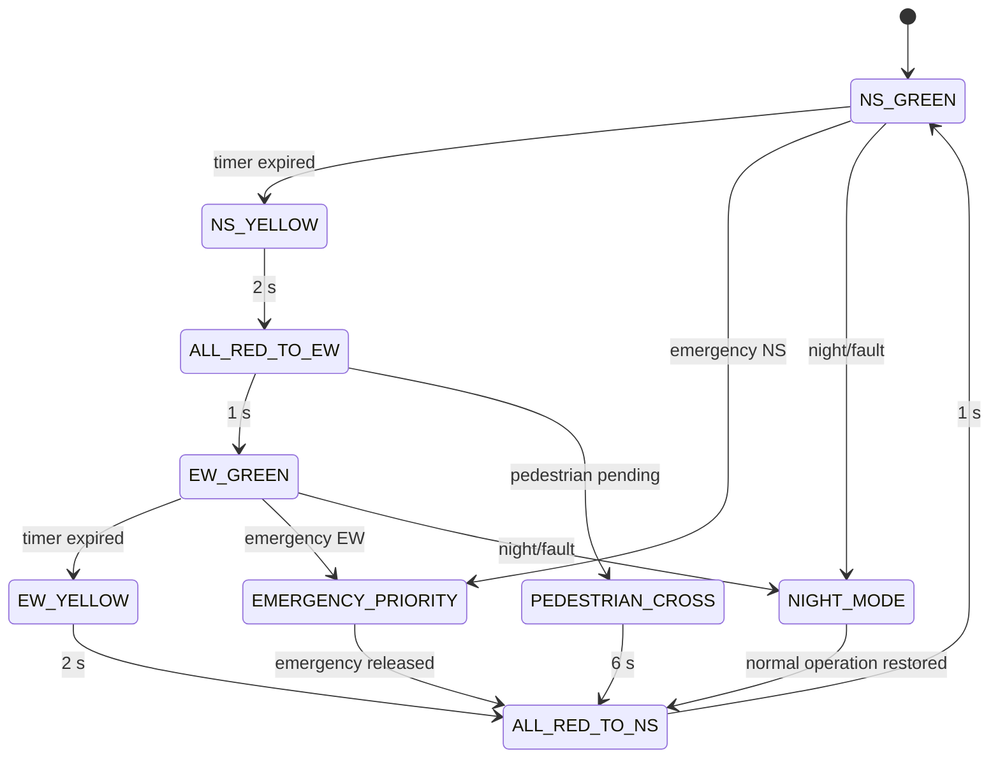

# سیستم چراغ راهنمای هوشمند تقاطع (Smart Traffic Light Controller)

**درس:** سیستم‌های نهفته بی‌درنگ (Real-Time Embedded Systems - RTES)  
**موضوع:** پروژه انفرادی کنترل چراغ تقاطع با حالت عادی، شبانه، عابر پیاده و اولویت خودروی امدادی.

## هدف پروژه

این پروژه یک مدل نرم‌افزاری برای کنترل چراغ راهنمای تقاطع ارائه می‌کند. رفتار سیستم با ماشین حالت محدود (FSM) مدل شده و مفاهیم Memory-Mapped I/O، وقفه، چندوظیفگی RTOS، همگام‌سازی، زمان‌بندی بی‌درنگ، WCET و پروتکل‌های ارتباطی در تمرین‌های جداگانه بررسی می‌شوند.

مطابق راهنمای پروژه درس، اجرای سخت‌افزار فیزیکی الزامی نیست؛ آدرس‌های ثبات و داده‌های سخت‌افزاری در این پروژه فرضی/شبیه‌سازی‌شده‌اند.

## فایل‌های پروژه

| فایل | کاربرد |
|---|---|
| `hw-01-fsm.md` | مدل FSM پایه، ورودی‌ها، خروجی‌ها و انتقال حالت |
| `hw-02-extended-fsm.md` | Extended FSM، متغیرها، Guardها و تایمر |
| `hw-03-composed-fsm.md` | ترکیب FSM منطق ترافیک و FSM ایمنی/اضطراری |
| `hw-4-memory_map.md` | نقشه آدرس‌های فرضی ثبات‌ها و سنسورها |
| `hw-5-main.c` | پیاده‌سازی مستقل FSM به زبان C استاندارد و شبیه‌سازی سناریوها |
| `hw-6-memory_budget.md` | برآورد حافظه Stack، Heap و Flash |
| `hw-8-isr.c` | نمونه ISR و قرارداد اعلان رویداد |
| `hw-9-rtos-tasks.c` | تفکیک وظایف RTOS و قرارداد Mutex/Semaphore |
| `hw-10-scheduling.md` | تحلیل بهره‌وری، RMS، EDF، پاسخ زمانی و Priority Inversion |
| `hw-11-wcet-opt.md` | تحلیل WCET و تکنیک‌های بهینه‌سازی |
| `hw-12-protocols.md` | مقایسه I2C، SPI و CAN و نمونه فریم داده |
| `git_release_guide.md` | راهنمای گردش‌کار Git و ایجاد تگ انتشار |

## ورودی‌ها و خروجی‌های اصلی

| نام | نوع | توضیح |
|---|---|---|
| `PED_BTN_REQ` | ورودی | درخواست عبور عابر پیاده |
| `EMG_VEH_SENS` | ورودی | تشخیص خودروی امدادی |
| `EMG_DIR` | ورودی | جهت خودروی امدادی: `NS` یا `EW` |
| `DENSITY_NS`, `DENSITY_EW` | ورودی | تراکم خودرو در دو مسیر |
| `NIGHT_MODE_EN` | ورودی | فعال‌سازی حالت شبانه |
| `NS_*`, `EW_*` | خروجی | چراغ‌های دو مسیر |
| `PED_WALK`, `PED_STOP` | خروجی | چراغ عابر پیاده |
| `SAFETY_FAULT_LED` | خروجی | نشانگر ایمنی/خطا |

## مدل کلی FSM



نمودار، نمای کلی مفهومی است؛ جزئیات Guardها و ترتیب اولویت رویدادها در فایل‌های تمرین مربوطه آمده است.

## کامپایل و اجرای برنامه مستقل FSM

نیازمندی: کامپایلر سازگار با C11 مانند GCC.

```bash
gcc -std=c11 -Wall -Wextra -Wpedantic hw-5-main.c -o traffic_sim
./traffic_sim
```

`hw-5-main.c` یک شبیه‌سازی مستقل مبتنی بر بانک ثبات نرم‌افزاری است؛ این فایل روی برد، مستقیماً به MMIO واقعی متصل نیست.

## وضعیت فایل RTOS

`hw-9-rtos-tasks.c` لایه وظایف برنامه و قرارداد API موردنیاز RTOS را نشان می‌دهد. برای اجرای واقعی باید توابع adapter اعلام‌شده در آن فایل به APIهای RTOS منتخب نگاشت شوند. Mutex باید مالکیت و blocking واقعی و Priority Inheritance را پشتیبانی کند؛ Semaphore نیز باید امکان انتظار/بیدارشدن تسک را فراهم کند. صرف تعریف متغیرهای `volatile` جایگزین این قابلیت‌ها نیست.

## فرضیات و محدودیت‌ها

- آدرس‌های `0x4000xxxx` در اسناد، آدرس فرضی‌اند.
- متغیرهای `sim_*` بانک ثبات نرم‌افزاری برای اجرای میزبان هستند.
- زمان اجرای تسک‌ها و WCET در اسناد تحلیلی تخمینی‌اند و باید روی پلتفرم نهایی اندازه‌گیری شوند.
- برای کاربرد واقعی ایمنی‌بحرانی، طراحی باید با سخت‌افزار، سنسورهای واقعی، watchdog، تشخیص خطا، تحلیل خطر و آزمون‌های رسمی اعتبارسنجی شود.
- حالت شب در نمونه فعلی با خروجی زرد ثابت نمایش داده شده است؛ چشمک‌زن واقعی به تایمر و کنترل خروجی دوره‌ای نیاز دارد.

## تحویل‌های نهایی مطابق راهنمای درس

فایل‌های تمرین شماره‌دار حفظ شده‌اند تا با الزام «یک فایل جداگانه برای هر جلسه» منطبق باشند. معادل چک‌لیست عمومی تحویل استاد عبارت‌اند از:
- `hw-4-memory_map.md` معادل `memory_map.md`
- `hw-6-memory_budget.md` معادل `memory_budget.md`
- `hw-5-main.c` معادل `main.c` برای پیاده‌سازی FSM مستقل

تگ Git با نام `v1.0` باید پس از تکمیل و بازبینی نهایی، واقعاً ساخته و Push شود؛ درج نام تگ در README به‌تنهایی آن را ایجاد نمی‌کند.

## ثبت فعالیت در Git

طبق راهنمای پروژه درس، تمرین هر جلسه باید پس از تدریس همان جلسه Push شود و حداقل هر دو هفته فعالیت Commit/Push وجود داشته باشد. تاریخچه Git را واقعی نگه دارید و برای فعالیت گذشته Commit یا تاریخ ساختگی ایجاد نکنید.
