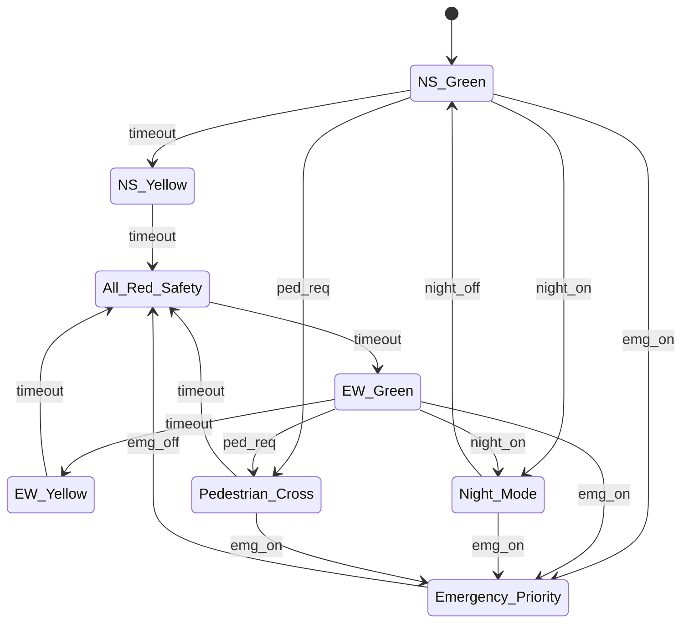

# تمرین جلسه ۱: ماشین حالت ساده (FSM) سیستم چراغ راهنمای هوشمند تقاطع
**دانشجو:** علیرضا طاعتی  
**فایل تمرینی:** `hw-01-fsm.md`

---

## تعریف رسمی ۵-تایی ماشین حالت (FSM)

ماشین حالت ساده سیستم چراغ راهنمای هوشمند تقاطع را می‌توان به صورت یک ۵-تایی مرتب به شکل $M = (S, \Sigma, \delta, s_0, F)$ تعریف کرد:

1. **مجموعه حالت‌ها ($S$):**
   * `S0`: `NS_Green` (حرکت آزاد مسیر شمالی–جنوبی)
   * `S1`: `NS_Yellow` (هشدار توقف مسیر شمالی–جنوبی)
   * `S2`: `EW_Green` (حرکت آزاد مسیر شرقی–غربی)
   * `S3`: `EW_Yellow` (هشدار توقف مسیر شرقی–غربی)
   * `S4`: `All_Red_Safety` (حالت قرمز ایمنی برای پاک‌سازی تقاطع)
   * `S5`: `Night_Mode` (حالت شبانه با چراغ هشدار چشمک‌زن)
   * `S6`: `Pedestrian_Cross` (عبور ایمن عابر پیاده)
   * `S7`: `Emergency_Priority` (اولویت عبور خودروی اضطراری)

2. **مجموعه ورودی‌ها / روادیدها ($\Sigma$):**
   * `timeout`: پایان زمان مجاز فاز جاری
   * `night_on`: فعال شدن حالت شبانه
   * `night_off`: خروج از حالت شبانه
   * `ped_req`: فشردن دکمه درخواست عابر پیاده
   * `emg_on`: تشخیص خودروی اضطراری
   * `emg_off`: اتمام عبور خودروی اضطراری

3. **تابع انتقال حالت ($\delta : S \times \Sigma \rightarrow S$):**
   * قانون گذار از حالت فعلی و ورودی به حالت بعدی طبق جدول زیر.

4. **حالت اولیه ($s_0$):**
   * `NS_Green`

5. **مجموعه حالت‌های نهایی / پایدار ($F$):**
   * سیستم کنترل تقاطع به صورت پیوسته کار می‌کند و در حالت عادی دارای چرخه پایدار است؛ تمامی حالت‌های تعریف‌شده در این مدل گسسته جزو حالت‌های معتبر سیستم هستند.

---

## نمودار حالت (Mermaid)

---

## جدول انتقال حالت (State Transition Table)

| حالت فعلی | رویداد / ورودی | حالت بعدی | خروجی شاخص |
| :--- | :--- | :--- | :--- |
| `NS_Green` | `timeout` | `NS_Yellow` | چراغ زرد مسیر شمالی–جنوبی روشن |
| `NS_Yellow` | `timeout` | `All_Red_Safety` | تمامی چراغ‌های خودرو قرمز ایمن |
| `All_Red_Safety` | `timeout` | `EW_Green` | چراغ سبز مسیر شرقی–غربی روشن |
| `EW_Green` | `timeout` | `EW_Yellow` | چراغ زرد مسیر شرقی–غربی روشن |
| `EW_Yellow` | `timeout` | `All_Red_Safety` | تمامی چراغ‌های خودرو قرمز ایمن |
| `NS_Green` / `EW_Green` | `night_on` | `Night_Mode` | چراغ زرد/قرمز چشمک‌زن شبانه |
| `Night_Mode` | `night_off` | `NS_Green` | بازگشت به چرخه عادی تقاطع |
| `NS_Green` / `EW_Green` | `ped_req` | `Pedestrian_Cross` | توقف خودروها و فعال شدن چراغ عابر |
| `Pedestrian_Cross` | `timeout` | `All_Red_Safety` | پایان عبور عابر و ورود به قرمز ایمن |
| هر حالت فعال | `emg_on` | `Emergency_Priority` | آزادسازی مسیر خودروی امدادی |
| `Emergency_Priority` | `emg_off` | `All_Red_Safety` | پاک‌سازی ایمن پیش از بازگشت به چرخه |
