# تمرین جلسه ۲: ماشین حالت توسعه‌یافته (Extended FSM) و مدیریت زمان
**دانشجو:** علیرضا طاعتی  
**فایل تمرینی:** `hw-02-extended-fsm.md`

---

## ارتقای مدل به ماشین حالت توسعه‌یافته (EFSM)

در ماشین حالت توسعه‌یافته، علاوه بر حالت‌ها و ورودی‌ها، از **متغیرهای حالت**، **شرط‌های نگهبان (Guards)** و **تایمر زمانی** برای تصمیم‌گیری دقیق‌تر بر اساس شرایط ترافیکی و ایمنی استفاده می‌شود.

### ۱. متغیرهای حالت (State Variables)
* `ns_density`: مقدار عددی تراکم خودرو در مسیر شمالی–جنوبی (مثلاً ۰ تا ۱۰۰).
* `ew_density`: مقدار عددی تراکم خودرو در مسیر شرقی–غربی (مثلاً ۰ تا ۱۰۰).
* `ped_pending`: پرچم ثبت درخواست عابر پیاده (`0` یا `1`).
* `emergency_active`: پرچم فعال بودن وضعیت اضطراری (`0` یا `1`).
* `night_flag`: وضعیت فعال بودن حالت شب (`0` یا `1`).

### ۲. تایمر زمانی (Timer)
* `phase_timer`: شمارنده زمانی بر حسب میلی‌ثانیه (`ms`) که مدت زمان ماندن در هر فاز یا بازه عبور عابر را کنترل می‌کند.

### ۳. شرط‌های نگهبان (Guards)
* **شرط نگهبان ۱ (`[emergency_active == 1]`):** تنها زمانی اجازه ورود فوری به حالت اضطراری داده می‌شود که سیگنال خودروی امدادی تایید شده باشد.
* **شرط نگهبان ۲ (`[ns_density > ew_density + 20]`):** زمانی که تراکم مسیر شمالی–جنوبی به شکل محسوسی بیشتر از مسیر شرقی–غربی باشد، زمان سبز مسیر شمالی–جنوبی تمدید می‌شود.
* **شرط نگهبان ۳ (`[phase_timer >= green_limit && ped_pending == 1]`):** پس از سپری شدن حداقل زمان سبز و وجود درخواست عابر، انتقال به مرحله عبور عابر پیاده انجام می‌شود.

### ۴. اکشن‌ها (Actions)
* **Entry Action:** هنگام ورود به حالت `NS_Green`، مقدار `phase_timer = 0` تنظیم و چراغ سبز مسیر شمالی–جنوبی روشن می‌شود.
* **During / Tick Action:** در هر تیک زمانی، مقدار `phase_timer` افزایش می‌یابد.
* **Exit Action:** هنگام خروج از حالت سبز، چراغ سبز خاموش شده و آماده‌سازی برای فاز زرد انجام می‌شود.

---

## نمودار Extended FSM (Mermaid)

```mermaid
stateDiagram-v2
    [*] --> NS_Green : init / phase_timer = 0; set_lights(NS_G)

    NS_Green --> NS_Green : tick [phase_timer < min_green] / phase_timer++
    NS_Green --> NS_Green : tick [phase_timer < max_green && ns_density > ew_density + 20] / phase_timer++
    NS_Green --> NS_Yellow : tick [phase_timer >= green_limit] / phase_timer = 0; set_lights(NS_Y)

    NS_Yellow --> All_Red_Safety : tick [phase_timer >= yellow_time] / phase_timer = 0; set_lights(ALL_R)
    All_Red_Safety --> EW_Green : tick [phase_timer >= all_red_time && ped_pending == 0] / phase_timer = 0; set_lights(EW_G)
    All_Red_Safety --> Pedestrian_Cross : tick [phase_timer >= all_red_time && ped_pending == 1] / phase_timer = 0; ped_pending = 0; set_lights(PED_WALK)

    Pedestrian_Cross --> All_Red_Safety : tick [phase_timer >= ped_walk_time] / phase_timer = 0; set_lights(ALL_R)

    EW_Green --> EW_Yellow : tick [phase_timer >= ew_green_limit] / phase_timer = 0; set_lights(EW_Y)
    EW_Yellow --> All_Red_Safety : tick [phase_timer >= yellow_time] / phase_timer = 0; set_lights(ALL_R)

    NS_Green --> Night_Mode : tick [night_flag == 1 && emergency_active == 0] / phase_timer = 0
    EW_Green --> Night_Mode : tick [night_flag == 1 && emergency_active == 0] / phase_timer = 0
    Night_Mode --> NS_Green : tick [night_flag == 0] / phase_timer = 0; set_lights(NS_G)

    NS_Green --> Emergency_Priority : emg_irq [emergency_active == 1] / phase_timer = 0; set_emg_route()
    EW_Green --> Emergency_Priority : emg_irq [emergency_active == 1] / phase_timer = 0; set_emg_route()
    Pedestrian_Cross --> Emergency_Priority : emg_irq [emergency_active == 1] / phase_timer = 0; set_emg_route()
    Night_Mode --> Emergency_Priority : emg_irq [emergency_active == 1] / phase_timer = 0; set_emg_route()
    Emergency_Priority --> All_Red_Safety : emg_clear [emergency_active == 0] / phase_timer = 0; set_lights(ALL_R)
```

