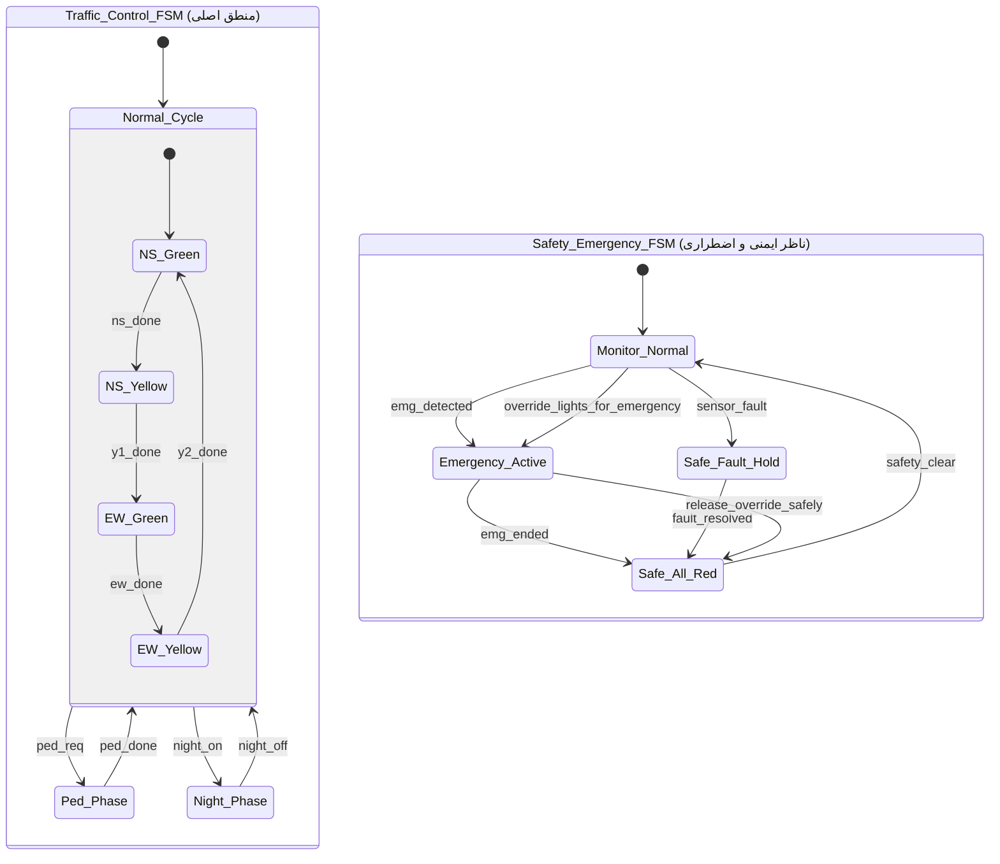

# تمرین جلسه ۳: ترکیب ماشین‌های حالت (Composition of State Machines)
**دانشجو:** علیرضا طاعتی  
**فایل تمرینی:** `hw-03-composed-fsm.md`

---

## معماری ترکیبی ماشین‌های حالت

در این مرحله، رفتار سیستم به دو ماشین حالت مجزا اما هماهنگ تقسیم می‌شود تا پیچیدگی کنترل کاهش یافته و ایمنی سیستم در شرایط بحرانی تضمین شود:

1. **ماشین حالت اول (`Traffic_Control_FSM` - منطق اصلی تقاطع):**  
   مسئول چرخش چراغ‌های مسیرهای شمالی–جنوبی و شرقی–غربی، تنظیم زمان‌بندی بر اساس تراکم و مدیریت عبور عابر پیاده و حالت شبانه است. این ماشین حالت خود دارای زیرحالت‌های سلسله‌مراتبی برای حالت عادی است.

2. **ماشین حالت دوم (`Safety_Emergency_FSM` - ناظر ایمنی و اولویت اضطراری):**  
   به صورت موازی و با اولویت بالاتر وضعیت اضطراری خودروهای امدادی و سلامت سیگنال‌ها را پایش می‌کند. هر زمان وضعیت اضطراری فعال شود یا خطای سیگنال رخ دهد، فرمان کنترل چراغ‌ها را به حالت ایمن یا مسیر اضطراری هدایت می‌کند.

---

## نوع ترکیب و حالت‌های ایمنی

* **ترکیب سلسله‌مراتبی (Hierarchical / Statecharts):** حالت `Normal_Operation` شامل زیرحالت‌های `NS_Green`، `NS_Yellow`، `EW_Green` و `EW_Yellow` است.
* **ترکیب همگام / ناظر (Synchronous Supervisor Composition):** در هر گام زمانی، ماشین ناظر ایمنی (`Safety_Emergency_FSM`) وضعیت اضطراری و خطا را بررسی کرده و خروجی نهایی چراغ‌ها را تعیین می‌کند.
* **حالت‌های ایمنی (Safety Modes):**
  * `Safe_All_Red`: توقف کامل همه جهت‌ها برای جلوگیری از برخورد در لحظه تغییر فاز یا خروج از حالت اضطراری.
  * `Safe_Fault_Hold`: نگه داشتن تقاطع در وضعیت ایمن در صورت بروز خطای ورودی/سخت‌افزاری.

---

## نمودار ترکیب ماشین‌های حالت (Mermaid)

